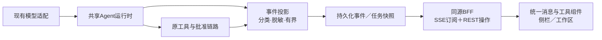

# 智能助手会话体验：调研、现状与升级建议

日期：2026-10-29。状态：研究及建议，未实施本文件新增方案。适用于 ai-office-example Agent 分支；不把早期茂泽“服务端无AI”口径套回模板。

本轮只核查源码、锁定依赖及公开官方资料，不改变在用实例、调用模型或发布。与已有 COPILOTKIT_FRONTEND_RESEARCH.md 衔接，本文聚焦会话交互和验收，不另建相互竞争的总体架构。

## 1. 结论

当前短板是执行过程不可见、输出延迟、回执偏技术化和答案不够简洁。单加“思考中”动画不能解决。应建立真实事件驱动的会话：用户能看清任务在做什么、查了什么、得到什么、哪里需要本人决定，以及失败后如何处理。

优先实施真实进度、文本流、工具状态与结果卡片、统一恢复体验及业务化答案。供应商公开提供的推理摘要是可选增强，不作为基本可用性的前提。不输出或诱导生成隐藏思维链，不伪造计划、工具进度、百分比或打字流。

## 2. 当前实现核查

| 位置 | 当前事实 | 体验影响 |
|---|---|---|
| clients/agent/src/office_agent/runtime.py | 使用 agent.run；DeferredToolRequests 外部批准后继续 run；最终 RunResult 包含 explanation、receipts、usage | 运行时未向宿主传递实时消息／工具事件 |
| app/application/agent_runner.py | 保存排队、运行、等待确认、写入在途与最终状态；observe主要保护写入回执 | 有安全状态，但缺面向用户的只读执行活动 |
| assistant-transport.js、assistant-shell.js | JSON fetch，约2秒轮询，错误退避；隐藏页面停轮询 | 不是SSE或真正token流；不能只改CSS实现流式 |
| assistant-view.js | 侧栏与全页复用；只读回执折叠，写入回执明显展示；支持批准、拒绝、停止 | 已有基础应复用；通用字段表和JSON不适合作为主要业务结果 |
| 锁定依赖 | pydantic-ai-slim 2.61.0；本机inspect确认run支持event_stream_handler，存在run_stream_events | 有增量改造入口；具体三协议与批准续跑仍需实现验收 |

既有会话、草稿、停止、历史、Markdown、工具回执和人工审批不能重复建设。没有推理展示不能证明模型没有推理，也不能证明当前第三方模型提供可展示摘要。

## 3. 官方参考与适用边界

1. [assistant-ui组件](https://www.assistant-ui.com/components)：可借鉴流式文本、工具分组、折叠摘要、消息操作、滚动跟随等成熟模式。它提供React组件，不自动提供本项目权限、审批和持久化。
2. [assistant-ui工具UI](https://www.assistant-ui.com/docs/tools)：工具可以用专用卡片呈现执行与交互。借鉴形态，服务端仍是业务成功的依据。
3. [AI Elements Reasoning](https://elements.ai-sdk.dev/components/reasoning)、[Tool](https://elements.ai-sdk.dev/components/tool)、[Confirmation](https://elements.ai-sdk.dev/components/confirmation)：分别参考摘要折叠、工具状态、批准／拒绝状态。当前[Chain of Thought页面](https://elements.ai-sdk.dev/components/chain-of-thought)提示迁往shadcn/ui及2026年11月底弃用计划，选依赖前必须重新核查迁移；本轮只作设计参考，未安装。
4. [CopilotKit固定组件UI](https://docs.copilotkit.ai/generative-ui/your-components/display-only)：支持把结构化结果映射为卡片、表格、状态等。建议使用自有白名单组件，不让模型任意生成可执行HTML/JS。
5. [AG-UI事件](https://docs.ag-ui.com/concepts/events)：区分run、text、tool、state、reasoning事件。可借其分类与后续适配，不把协议当数据库、鉴权或恢复系统。
6. [PydanticAI运行与流式](https://pydantic.dev/docs/ai/core-concepts/agent/)：run的event_stream_handler可观察事件；run_stream_events可输出整个执行过程。普通run_stream可能把先出现的匹配文本判为最终输出，不宜机械替换现有循环，否则会改变工具执行语义。Context7和锁定安装的函数签名已交叉核查，尚未进行流式原型测试。
7. [OpenAI推理摘要](https://developers.openai.com/api/docs/guides/reasoning?api-mode=chat)、[Anthropic Thinking](https://platform.claude.com/docs/en/build-with-claude/thinking)：公开摘要、支持模型及配置方式存在差别，不应对所有OpenAI兼容网关发送同一套参数。摘要不等于完整内部推理，亦不等于事实证据。
8. [WCAG状态消息](https://www.w3.org/WAI/WCAG22/Understanding/status-messages.html)：重要状态变化应可由辅助技术感知，同时不抢焦点；不能逐token播报扰乱使用。

UI/UX Pro Max辅助检查用于焦点、布局稳定、减少动态效果、可访问性；其通用生成结果偏营销页，不采纳相关页面结构或改写现有品牌主题。

## 4. “思考过程”的三种不同信息

| 信息 | 来源 | 推荐展示 |
|---|---|---|
| 执行状态 | 后台实际事件 | 默认显示“正在读取本人权限”“正在整理结果”等，含真实耗时 |
| 计划／处理说明 | 用户可见的简短计划或模型公开说明 | 复杂任务可用；计划标为计划，执行结果另计，简单问答不强制出计划 |
| 推理摘要 | 供应商明确提供的可展示摘要 | 默认收起，按能力启用；不支持时不显示空占位，不另付费生成伪摘要 |

不把原始ThinkingPart直接当作已获准的公开摘要。encrypted/signature仅在供应商协议需要时服务端保留，不当显示文字，不发到客户端。不为了展示更长思考默认提高所有请求的推理预算。

## 5. 功能优先级与产品表现

### P0：先补齐等待与执行闭环

- **阶段行**：已受理／读取数据／等待模型／生成回复／等待本人确认／完成／失败／已停止／结果待核实。由实际事件驱动，不循环播假阶段。
- **流式回复**：收到真实文本增量再显示；区分中途说明、答案草稿与最终完成。网关不支持stream时清楚退回非流式，禁止因失败自动重放可能计费的调用。
- **工具卡片**：中文操作名、进行中／完成／失败／拒绝、真实耗时、简短结果。完整参数和JSON放详情，默认脱敏，不展示未完成参数为已执行操作。
- **结果组织**：结论先行；区分权限、当前工具可执行能力及需确认的写入。权限查询用中文分组，权限码默认折叠。模型描述不能取代真实授权判断。
- **审批就地闭环**：复用现有冻结预览，展示对象、变更、影响及批准／拒绝；已处理或过期卡片不可再次提交。看到工具文本不等于已批准或已执行。
- **错误可操作**：说明失败阶段、已完成内容、是否存在未知结果；提供查状态／看详情／明确重新发起。恢复显示与重新执行分别设计，未知写入不自动重试。
- **稳定滚动和输入**：流式更新不重建整条DOM，不抢选中文字或焦点；用户向上阅读时停止自动跟随；出现“回到最新”。会话切换保草稿，中文输入法发送不误触。

### P1：增加效率与结果价值

- **可折叠公开推理摘要**：按协议／模型能力配置，支持用户手动展开状态，摘要完成后默认折叠；不把工具步骤与摘要混成“模型真实全部思考”。
- **主动澄清卡片**：有歧义时提供少量可选项和自由补充，显示等待回复。模型追问、业务批准是不同类型，不能共用批准按钮。
- **结构化结果**：权限分组、记录列表、聚合表格、来源和覆盖提示；引用真实记录／版本或文档，不用模型编造引用。统计数字来自工具计算。
- **产物区**：生成的表格、报表或文件可预览、下载、继续处理；链接和下载仍需当前权限与有效期校验，不把文本里的URL直接当可信制品。
- **消息操作**：复制、引用追问、导出、明确重新生成。编辑历史消息需新分支／新轮次，不抹掉已有审批和执行记录。重新生成可能调用模型，不能伪装为本地刷新。
- **上下文提示**：清楚显示关联页面和主动选定资料，允许移除；不静默收集页面全部内容，也不将页面标签当项目权限。
- **任务信息**：用户默认看阶段与耗时，模型、修订、用量及追踪号放详情；供应商未返回用量时显示不可用，不估成已计费金额。

### P2：有明确需求再引入

附件解析、语音、联网搜索、跨会话记忆、自动建议、多Agent分工、长任务后台通知。各自涉及新数据边界、费用、权限或运行模式，不能作为“美化聊天”顺带接入。附件尤其需要独立上传、病毒/格式/大小处理、隔离存储和模型数据许可。

## 6. PC侧栏与工作区设计

侧栏用于短问答、当前页面辅助和快速确认；全页用于长输出、历史、表格与产物。复用同一会话模型、事件归约器、消息渲染器与工具卡片，不再各写一套。切换视图不创建新任务、不丢状态。

每轮建议顺序：用户消息 → 一行活动摘要（展开可看步骤）→ 流式回答／结果卡片 → 来源及覆盖提示 → 必要操作。技术诊断与原始回执收进详情，不堆满首屏。

示意（设计文案，非实际执行回执）：

```text
我有哪些权限？

⌄ 已完成 · 2项查询
  ✓ 读取本人身份与权限
  ✓ 查询当前可用能力

你当前是基础管理员，可管理人员、授权，并查询项目数据。

人员与授权   查看、开通和维护人员，调整角色及权限集
项目与数据   查询数据、统计导出，按权限提交和确认数据
账号与设备   查看和管理客户端授权

写入操作会先展示变更预览，等待你确认后再执行。
[查看全部权限]  [工具详情]
```

示意的勾选只在真实操作完成后显示。整体延续当前设计token、SVG、圆角、焦点环；150～200ms轻量过渡为建议值，尊重reduced-motion。工具展开不撑变其他业务表格，不用闪烁动效制造活跃感。

## 7. 推荐技术路径

保留FastAPI、PG、身份、权限、领域层及当前审批机制。先确立自有受控事件契约，再选择渲染器；不直接把SDK原始事件、参数或供应商历史透传浏览器。

建议链路：



- 起步优先评估在现有run调用增加event_stream_handler，续跑也必须接同一观察链路，保持累计预算与DeferredTool审批语义。run_stream_events为可选替代，需原型比较，不能把二者重复执行同一次请求。
- 事件最少包含schema版本、run_id、稳定event_id、单调seq、时间、类型、关联part/tool/step及有界payload。开始／结束／失败／未知结果分开；工具参数接收完成不是执行成功。真实执行回执仍来自原业务应用层。
- POST创建任务；GET订阅已存在任务。SSE重连只补展示，不创建／续跑任务；REST负责批准、停止等变更。跨设备幂等和版本校验照旧。
- 任务终态与最终结果为权威快照。事件序号与快照游标关联；重复事件去重、序号缺口拉快照。事件保留期结束提供重置语义；历史已收起的摘要和回执仍可重放呈现。
- 重连、心跳、撤权、会话过期及代理缓冲必须验证；订阅期间也需检查权限变化，不能只在建立连接时检查。新接口不传token到URL。
- 事件写入合并小增量，不能逐token建数据库事务；队列与字节有上限，慢订阅者可重连拉快照。事件保存失败时不得错误声称业务写入失败并诱发重试。
- 停止生成不代表回滚。浏览器断开不自动取消后台任务；停止之后已有提交仍保留回执，无法判定时保持outcome_unknown。
- 对脱敏内容跨chunk匹配需专门处理，不能逐个token正则处理后就宣称已脱敏；审批预览与业务回执持续遵守既有可见性规则。
- 推理摘要、运行记录和业务审计有不同保留需求；不将每个文本delta写进不可变业务审计，避免存储膨胀和敏感数据复制。

前端沿用原研究建议：React＋静态构建是优先验证路线，assistant-ui是聊天组件候选；CopilotKit参考体验与固定组件方案。新UI不必改写整个控制台或新增Node运行服务。最终引入库前验证版本、许可、包体、遥测、中文输入、现有审批适配；本轮未安装、没有替用户锁定新框架。AG-UI可加在自有事件上的独立适配层，不替代已有业务接口契约。

## 8. 实施顺序与验收门槛

1. 定义状态／事件和显示权限；覆盖无工具、单工具、多工具、批准拒绝、失败及未知写入，用合成模型验证顺序和边界。
2. 共享运行时事件与服务端投影、快照、SSE；测试断线、去重、慢消费、撤权和取消，不改原业务规则。
3. 统一阶段行、工具卡片、增量消息及滚动；相同案例验证侧栏／全页／导航往返／刷新。
4. 简洁回答、中文权限卡片、真实来源和覆盖提示；原始回执继续可查。失败回答不能输出正常成功卡片。
5. 三协议流式与可选推理摘要分别验收：有摘要／无摘要／不支持stream／超时／预算耗尽；不增加默认模型请求次数，不用额外模型生成状态说明。
6. 做最小React组件原型与当前栈对照后明确选型；不能把样例好看当现有权限与部署闭环已经通过。

必须通过：重复连接不增加模型请求或重复写入；停止后不丢已提交回执；未批准写入零执行；权限撤销后不能继续获取历史或事件；输出能清楚区分草稿／最终／覆盖不全；无摘要模型仍正常；长文本／表格无横向破坏；键盘、IME、屏幕阅读器、reduced-motion可用；截图与实际运行证据分别记录。首反馈耗时、首字耗时、长等待空白时长、DOM更新和事件写入量需测量后设性能目标，不预先承诺未经验证的数值。

## 9. 未确认事项

当前第三方端点是否为所选模型提供stream和可展示reasoning summary；单独能力测试后再开。API协议名不等于能力承诺。附件、搜索、长记忆和多Agent仍为未来范围。本文未进行真实供应商新调用、UI原型或实现测试；源码核查和文档能力不能代替这些验收。
