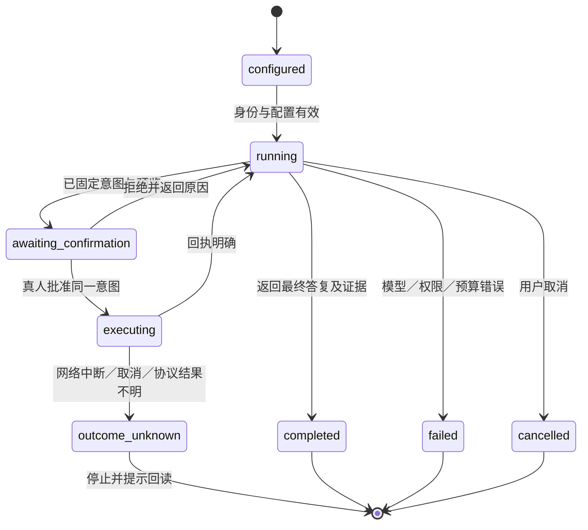

# Agent 运行时设计草案

版本0.1，2026-10-25。状态：已具备隔离实验依据，**员工端／独立服务运行位置待确认**，不是已实现能力。实现计划见[AGENT_PLAN](AGENT_PLAN.md)，来源见[AGENT_RESEARCH](AGENT_RESEARCH.md)。本文只适用于Agent分支，不修改main及既有v1.0.0部署的承诺。

## 1. 交付目标与非目标

交付通用自然语言任务入口：理解员工目标、发现可用能力、受控读取、形成变更、展示预览、等待真人、调用既有服务、返回带证据和状态的结果。支持模型替换、依赖隔离、预算、取消、失败分类和可复现测试；原技能宿主继续可用。

不默认加入行业流程、自治员工、多Agent团队、任意浏览器操作、代码执行、定时任务、长期向量记忆、模型训练或通用知识库。它们并非永远不做，而是不能以“Agent”之名自动开放。

## 2. 部署路线比较

| 路线 | 员工体验 | 运行与秘密 | 主要代价 | 适用判据 |
|---|---|---|---|---|
| 现有AI工具＋技能 | 保留当前入口 | 模型由宿主管；企业凭证按既有SDK／MCP | 无独立Agent，行为依赖宿主 | 已有AI工具足够 |
| 独立员工端Agent（首选候选） | 终端对话／单次任务，可被桌面工具包装 | 模型与企业授权分开，企业token继续安全存储 | 员工安装增加一个可选包；进程退出即结束会话 | 需要独立运行，但不要求24小时、多人接管 |
| 独立Agent服务（可选路线） | 可用Web对话、集中配置 | 模型密钥在新服务；需用户身份委托，不能复用老板总token | 会话隔离、队列、审批通道、租约、凭证与部署增量明显 | 明确需要后台／跨设备／Web对话 |

即使选择第三条，数据服务仍可保持无AI：Agent是单独进程和部署单元，通过受控API访问数据，不把模型和任务循环塞入数据服务请求进程。不能把服务端拥有数据库账号理解成Agent也该拥有它。

## 3. 建议模块与依赖

独立包候选：`clients/agent/`，Python3.13／3.14；品牌复用template.toml及生成的product，不另设品牌文件。包版本与模板版本策略一并核验。是否加入根workspace，须验证服务器镜像和员工安装器不会被迫安装模型依赖，再决定；不预设“加入workspace就自动安全隔离”。

| 模块 | 单一职责 | 不应承担 |
|---|---|---|
| config | 服务、provider、模型、数据处理政策及预算校验 | 保存企业token／打印模型密钥 |
| providers | 创建／关闭模型客户端，供应商差异和超时 | 企业业务规则和权限判断 |
| tools | 固定工具注册、参数验证、结果预算和来源 | 任意URL／SQL／shell，复制服务端模型 |
| runtime | 执行循环、用量、取消、会话和状态协调 | 重新实现整套Agent框架 |
| approval | 与真人交互，绑定不可变意图和预览 | 把模型说“批准”当真人同意 |
| cli | 参数、帮助、交互、可读结果与退出码 | 另建认证／写入规则 |
| tests | 框架适配、工具序列、真实本地网络和负例 | 用假模型证明真实模型质量 |

选择成熟框架负责模型协议和循环；项目只实现企业工具及策略。框架类型不应渗入数据服务模块和通用SDK。SDK当前为同步HTTP；不能在async事件循环直接调用它，也不能将一个有状态SDK跨线程并发共享。候选桥接使用每运行独占的单线程调用通道，所有SDK调用和close在同一线程串行执行；异步取消不能强杀已经发出的同步写请求，必须标为结果未知并回读。若桥接复杂度实测不合理，再评估独立异步SDK，而不是复制一套HTTP／认证。

## 4. 工具能力矩阵

表中名称参考已有MCP／SDK真实入口，最终注册从单一适配表派生描述及测试。HTTP和MCP不能互为绕过路径。服务端现有模型仍是参数和权限的权威；Agent侧检查只能提前报错。

| 类别 | 现有能力 | Agent策略 |
|---|---|---|
| 身份与发现 | whoami、capabilities、account_capabilities | 固定服务先核对，不输出token；能力目录不代表当前调用一定获准 |
| 数据读取 | list_projects、project_schema、list_records、get_record、confirmed_record、record_history | 用真实ID、修订和范围；受限分页，不默认遍历全库 |
| 分析导出 | aggregate_data、export_confirmed_records | 复用已有类型／预算／覆盖，原始结果与解释分离；导出到文件需显式目标 |
| 人员权限 | list_access、access_detail、access_links、pending_identities | 实时服务端授权；完整关联替换先读集合，不丢非目标关系 |
| 账号管理 | search_login_accounts、employee_account、account_operation、account_operation_history | 不索要或输出密码；危险动作复用服务端操作记录 |
| 授权管理 | list_client_authorizations | 本人和全企业范围明确；后者需既有权限 |
| 服务端预览 | preview_data_change、preview_access_change、preview_account_operation、preview_account_resume | 模型可提出意图、读取精确预览；预览绝不代表批准 |
| 数据／权限提交 | apply_data_change、apply_access_change、submit_account_operation、resume_account_operation | 仅模型外确认后执行同一预览，冻结参数和原幂等键，不开放可由模型传入的approved字段 |
| 记录写入 | submit_record、confirm_record、correct_record | 固定内容和版本，展示结构／来源／状态，确认后提交；确认事实和上报候选不同 |
| 授权变更 | describe_client_device、change_client_authorization | 展示设备、作用范围、影响及版本；当前会话可能失效，不能把随后401当作未执行 |
| 身份交互 | login、logout | 终端本人发起，不由模型调用或代输密码；登录及改密的浏览器环节由本人处理 |

未注册工具必须拒绝，不能getattr任意SDK属性，也不能因为服务返回一个URL便创建新工具。工具结果保留trace、来源和覆盖警告，限制字节数；超限返回结构化提示要求缩小范围，不能把截断JSON交给模型冒充完整结果。

## 5. 执行和确认状态

审批记录至少绑定：服务实例、当前员工、run_id、工具／操作、规范化完整参数、服务端预览摘要、目标版本及创建时点。不是只显示操作名或只批准一个工具类别。模型侧拿不到可复用批准凭证；默认不支持approve-all、自动批准管理操作和跨任务继承批准。

批准前重新核对身份与预览有效性；任一变更须再展示和确认。服务端仍执行自己的授权、版本和摘要检查；客户端不能阻止恶意客户端伪称真人，因此不能把客户端审批包装成服务器强制双人审批。

进程内审批先实现完整；退出后未执行提案作废。默认不保存全量会话／待批准请求到文件，避免多用户、跨服务和历史版本重放。未来如果引入持久任务，需具备任务版本、存储隔离／加密、TTL、原子认领、幂等执行及未知结果对账，再开放恢复。

## 6. 配置、数据与密钥

配置只包含公开服务地址、模型标识、provider端点及秘密引用，不包含秘密本身。模型秘密与企业浏览器凭证分开；provider凭证不得用于企业API，反之亦然。首版不擅自复用宿主订阅、捕获宿主token或读取其他AI工具的配置。

企业数据是否可以交给指定模型是单独政策，不能靠HTTPS就视为获准。未明确允许前不发业务资料；认证秘密始终不得进入模型。字段脱敏无法自动覆盖所有敏感语义，不能宣称通用正则实现了完整合规；需要企业明确端点与允许的数据范围，并以最少字段提供证据。默认关闭远程trace、请求正文日志和自动云端会话。

server、model和预算只由可信配置／真人交互提供，模型不能修改。HTTP演示模式沿用显式开关；模型服务若为本机推理，可单独核验loopback端点，不能扩大为默认允许任意内网HTTP模型地址。

## 7. 预算、异步和错误

候选默认值需试跑校准，而不是无限开放：每次任务最多8次模型请求、20次工具调用、10页查询、120秒墙钟；输入、单工具结果和最终输出分别有字节上限。用户可在有界配置内调整；不通过prompt修改。使用框架RunUsage在暂停恢复之间累计，避免每次确认后预算归零。token／费用限制受provider计量能力约束，报告实际可证明的计量范围。

| 情况 | 行为 |
|---|---|
| 配置缺失／坏URL | 本地拒绝，给出配置方法，不猜测地址 |
| 未登录／凭证过期 | 提示本人执行既有登录；不自动收集密码 |
| 403 | 明确当前权限不足，不换账号或入口 |
| 参数／schema错误 | 返回可修正字段，受预算约束；不自动改写业务语义 |
| 版本／摘要冲突 | 废弃原批准，重新读取与预览 |
| 模型429／不可用 | 有界失败，明确模型阶段，不重放业务写入 |
| 工具数据超限／分页未全 | 保留覆盖提示，缩小查询；不丢警告后总结成全量 |
| 写入结果未知 | 停止自动任务，保存最少定位信息，提示查询实际状态 |
| 输入中含恶意指令 | 外部资料作为数据；固定工具及模型外写门仍独立有效 |
| Ctrl+C／超时 | 取消后续模型调用，关闭资源；已发写入按未知结果处理 |

SDK／模型客户端、线程和task必须在成功、失败、拒绝及取消路径释放。先单运行隔离，不预设后台无限并发；事件循环不能被终端input、同步网络和重计算堵塞。

## 8. 验收分层与完成定义

1. 基线：已有536项非live测试通过（2026-10-25，本轮实际执行）；不据此宣称70项live已通过。
2. 框架隔离实验：Pydantic AI slim 2.61.0＋openai extra，Python3.13.7，共解析安装26个包；依赖一致性检查通过。已验证延迟调用无写入、拒绝无写入、批准执行一次及请求上限阻断循环。没有调用付费模型。
3. 实现验收：每项工具注册和拒绝、审批参数冻结、预算跨恢复、错误脱敏、线程释放、取消及重复写保护须有测试。
4. 网络验收：通过真实本地HTTP或受控transport验证模型协议、工具参数、未知结果，不以纯Mock证明真实网络完整性。
5. 服务验收：专用PG／Keycloak实例验证角色变化、授权停用、版本冲突及审计；不修改当前已部署实例。
6. 交付验收：原服务镜像无模型依赖；独立Agent wheel可安装；定制品牌可用；CLI帮助和缺配置可读；CI加入相应门禁。
7. 模型验收：真实provider需要明确获准的端点、模型、数据和调用预算；缺少时记录未验收，不拿测试模型的绿灯冒充业务效果。

完成声明必须逐项对应证据。代码和隔离门通过后可称框架实现完成，不能扩展成所有模型兼容、Windows真人操作、正式数据合规或生产上线完成。
