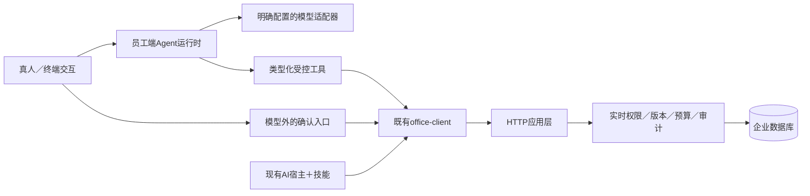

# Agent 分支设计与执行计划

版本：草案0.1，2026-10-25；分支：`codex/agent`。研究依据见[调研记录](AGENT_RESEARCH.md)，具体工具矩阵、状态、配置与验收见[运行时设计](AGENT_DESIGN.md)。完整目标是让模板可用于Agent开发，具备可运行、受控、可验证的通用任务链路；创建目录或接通一次模型不算完成。

## 1. 架构候选与范围

首选保持原数据服务／Web无AI，新增独立员工端Agent。服务端Agent／Web对话属于另一部署和权限边界，待用户明确。现阶段不修改在用实例、全局CLI和技能，不推送、不发布、不调用付费模型。

单向依赖：Agent → SDK → HTTP；Agent不导入服务端app，不连接数据库，不改原角色、权限、响应包装和业务码。读取能力与写预览可供模型调用；写提交必须受模型外确认约束。Agent只接现有通用数据和管理能力，不含客户字段、报表指标或行业角色。

建议目录是`clients/agent/`独立发行包，而不是把模型依赖塞进`clients/python/`或服务端。内部按配置、模型适配、工具、运行、交互和测试职责拆分，确认实际规模后决定文件，避免预建大量空目录。CLI命令品牌复用template.toml，不新增独立品牌来源。

## 2. 全链路验收要求

| 链路 | 要求 | 证明方式 |
|---|---|---|
| 配置 | 缺少服务、模型或授权时明确提示，拒绝不可信URL；无明文token落盘 | 负向配置测试、CLI实际调用 |
| 身份 | 使用原浏览器授权与安全存储，每次服务端实时校验；模型看不到token | 隔离身份测试及泄露哨兵 |
| 输入 | 有界文本，外部文件不是指令；不任意打开本机文件或URL | 大输入、注入、路径负例 |
| 工具 | 类型化参数、固定注册、没有任意SQL／HTTP／shell | 注册覆盖与未知工具测试 |
| 查询 | 有界分页、覆盖状态不丢，schema修订和字段语义明确 | 多页、截断、混合修订测试 |
| 预览／写入 | 展示精确变化，真人确认；拒绝不写、变更重确认、未知结果不重放 | 真实本地工具序列、批准/拒绝/冲突/超时 |
| 模型 | 多provider可插拔，不默认外部trace；请求、工具、token和时间预算 | 固定版本测试模型、受控网络模拟 |
| 输出 | 事实与模型解释分开，保留覆盖／警告；不把候选称确认，不宣称消息已发 | 结构化输出断言、失败场景 |
| 生命周期 | 取消、异常和退出关闭连接，不跨任务共享有状态客户端 | 取消和并发隔离测试 |
| 安装 | 独立wheel，服务器和原CLI安装无需Agent依赖；品牌可生成 | 独立消费及生成器测试 |
| 回归 | 既有契约、技能、权限、服务和部署不退化 | 原门禁＋相关端到端验收 |
| 真实效果 | 获准模型和独立企业测试实例完成自然语言任务 | 真实模型调用记录；未配置时明确未验收 |

## 3. 分阶段任务

- [x] P0：核对仓库、创建Agent分支、读取现有边界。
- [x] P1a：调研七类开源候选，记录官方资料、版本、适配及反证。
- [ ] P1b：确定员工端／独立Agent服务范围，验证候选运行时实际API、解析与安全成本。
- [ ] P2：冻结准确方案、目录、配置、状态、工具矩阵、失败和回滚规则。
- [ ] P3：实现独立包、模型适配、工具桥、预算、取消和模型外确认；每段配套验证。
- [ ] P4：接入CLI交互、可配置品牌、规则复用、独立发行和CI。
- [ ] P5：完整静态与隔离回归、安装消费、受控网络及授权失败验收，修复发现问题。
- [ ] P6：有明确模型／测试实例条件时验证真实自然语言全链路；同步使用说明和验收边界。
- [ ] P7：审核差异、提交已验证成果。推送／合并／发版另按授权。

## 4. 风险与回滚

新增Agent仅在新分支和独立包中实现；原服务数据库不迁移，现有SDK和技能入口继续可用。没有运行时依赖的服务器不应因Agent被迫安装模型SDK。回滚停止Agent进程／卸载新增包，不删除业务记录；已执行的业务写入只能走既有更正机制，不能以代码回滚伪称数据回滚。

模型输出不可能被证明永远正确。验收目标是工具权限不可绕过、写操作受控、失败可见、预算有上限以及可复现证据；不使用“完美”作为未经验证的安全承诺。生产模型质量、费用和敏感数据处理由明确的模型配置与企业政策约束。
