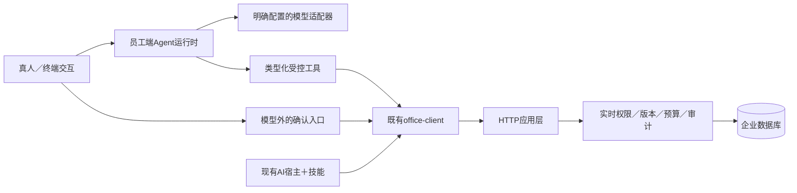

# Agent 分支设计与执行计划

版本：0.3，2026-10-25；分支：`codex/agent`。用户已明确要求服务端和员工端均支持AI；最新方向见[智能体总体方案](AGENT_PLATFORM_DESIGN.md)。研究依据见[调研记录](AGENT_RESEARCH.md)，员工端工具、配置和验收见[运行时设计](AGENT_DESIGN.md)。完整目标是升级整个模板为智能体基座；创建目录、只做客户端或接通一次模型不算完成。

## 1. 架构候选与范围

采用共享运行时，支持员工端执行、服务端内部Agent与外部HTTP／MCP调用。内部Agent复用原应用端口与当前员工，不透传token给新服务，不使用超级账号替用户操作；Web提供低门槛入口与服务器持有的审批状态。现阶段不修改在用实例、全局CLI和技能，不推送、不发布、不调用付费模型。

共享引擎依赖工具端口，员工端经SDK→HTTP，内部适配经异步Application；共享引擎不导入服务端app、不连接数据库。沿用原权限与响应规范，新增agent.run权限和429002容量业务码，启用503007执行不可用业务码。读取能力与写预览可供模型调用；写提交必须受模型外确认约束。Agent只接现有通用数据和管理能力，不含客户字段、报表指标或行业角色。

建议目录是`clients/agent/`独立发行包，而不是把模型依赖塞进`clients/python/`或服务端。内部按配置、模型适配、工具、运行、交互和测试职责拆分，确认实际规模后决定文件，避免预建大量空目录。CLI命令品牌复用template.toml，不新增独立品牌来源。

## 2. 全链路验收要求

| 链路 | 要求 | 证明方式 |
|---|---|---|
| 配置 | 缺少服务、模型或授权时明确提示，拒绝不可信URL；无明文token落盘 | 负向配置测试、CLI实际调用 |
| 身份 | 使用原浏览器授权与安全存储，每次服务端实时校验；模型看不到token | 隔离身份测试及泄露哨兵 |
| 输入 | 有界文本，外部文件不是指令；不任意打开本机文件或URL | 大输入、注入、路径负例 |
| 工具 | 类型化参数、固定注册、没有任意SQL／HTTP／shell | 注册覆盖与未知工具测试 |
| 查询 | 有界分页、覆盖状态不丢，schema修订和字段语义明确 | 多页、截断、混合修订测试 |
| 预览／写入 | 展示精确变化，真人确认；拒绝不写、变更重确认、未知结果不重放 | 真实本地工具序列、批准/拒绝/冲突/超时 |
| 模型 | 多provider可插拔，不默认外部trace；请求、工具、token和时间预算 | 固定版本测试模型、受控网络模拟 |
| 输出 | 事实与模型解释分开，保留覆盖／警告；不把候选称确认，不宣称消息已发 | 结构化输出断言、失败场景 |
| 生命周期 | 取消、异常和退出关闭连接，不跨任务共享有状态客户端 | 取消和并发隔离测试 |
| 安装 | 独立wheel，服务器和原CLI安装无需Agent依赖；品牌可生成 | 独立消费及生成器测试 |
| 回归 | 既有契约、技能、权限、服务和部署不退化 | 原门禁＋相关端到端验收 |
| 真实效果 | 获准模型和独立企业测试实例完成自然语言任务 | 真实模型调用记录；未配置时明确未验收 |

## 3. 分阶段任务

- [x] P0：核对仓库、创建Agent分支、读取现有边界。
- [x] P1a：调研七类开源候选，记录官方资料、版本、适配及反证。
- [x] P1b：用户确认两端AI；比较内部模块、独立服务和外部接入，补充本地BeefTV／Pi及AG-UI、A2A依据。
- [x] P2a：员工端准确工具、配置、状态、预算与失败边界。
- [x] P3a：可选包、首个模型协议适配、SDK串行线程、累计预算、取消和模型外确认。
- [x] P3b：抽出共享循环；内部异步应用工具桥，逐次认证、生产参数校验与拒绝验证。
- [x] P2b：服务端任务持久状态、权限、审批、重启和Web契约细化并实施。
- [x] P4a：服务端内部Agent协调、模型配置、任务归属、持久状态、审批、取消及审计。
- [x] P4b：Web智能助手、状态／回执和审批体验，复用现有组件并做浏览器验收。
- [ ] P5：候选发布脚本已补入独立Agent资产，需完成整套真实候选构建后再关闭。此前完成本地多端打包、可选依赖、部署入口与CI配置；回归、隔离消费和权限负例验收通过。远端CI尚未触发，真实企业部署另验。
- [ ] P6：获准真实模型／数据后单独验收自然语言效果；缺少条件时记录边界，不冒充供应商通过。
- [x] P7：完成本轮全局审核、文档同步并提交阶段成果；推送／合并／发版另按授权。

阶段证据（本地，2026-10-25）：

- 549项基础回归通过；共享引擎31项测试在Python3.13／3.14通过，内部原生桥8项包含在基础回归中。
- 真实独立PG18正式迁移、共享循环、任务持久化、HTTP／MCP、真人门、越权、丢回执取消、停用前阻断、重启中断与数据库就绪共9项通过。模型及身份均为显式测试替身，不冒充供应商／OIDC验收。
- 独立本机应用＋Chromium（本机Chrome测试上下文）通过真实页面、XSS转义、统一弹窗、取消不批准、一次提交及无横向溢出检查；不使用现有浏览器账号。
- 新构建的三个轮包在仓库外干净环境安装，导入路径、CLI入口、31项运行时测试与依赖一致性均通过。
- 架构、48项操作覆盖、契约生成物、品牌生成、类型检查均通过。新增CI已配置，尚未推送执行。
- 普通／Agent两种Docker镜像均完成构建与禁网实际导入核验；前者不安装pydantic_ai，后者可加载内部运行时。模型依赖漏洞审计未发现已知漏洞，已暂存源码Gitleaks扫描未发现秘密。运行指南见[AGENT_OPERATIONS](AGENT_OPERATIONS.md)；真实供应商效果仍属于P6的独立条件验收。

## 4. 风险与回滚

新增Agent仅在新分支和独立包中实现；在用实例本轮不迁移；分支新增正式0012迁移用于未来安装／升级，现有SDK和技能入口继续可用。没有运行时依赖的服务器不应因Agent被迫安装模型SDK。回滚停止Agent进程／卸载新增包，不删除业务记录；已执行的业务写入只能走既有更正机制，不能以代码回滚伪称数据回滚。

模型输出不可能被证明永远正确。验收目标是工具权限不可绕过、写操作受控、失败可见、预算有上限以及可复现证据；不使用“完美”作为未经验证的安全承诺。生产模型质量、费用和敏感数据处理由明确的模型配置与企业政策约束。
