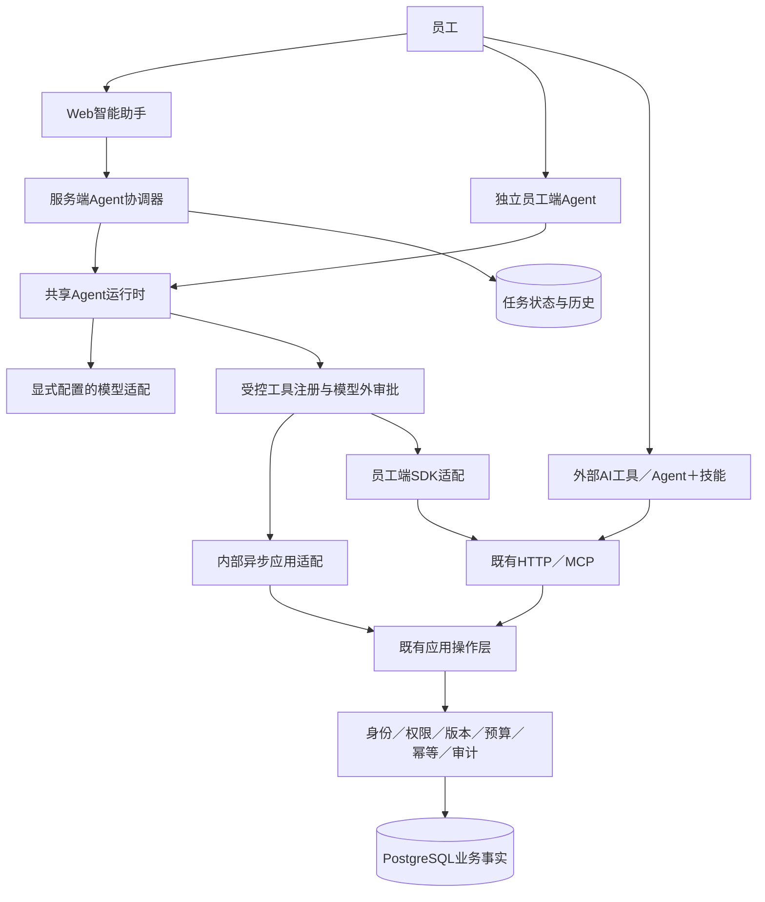

# 智能体基座总体方案

版本：0.2。2026-10-25用户明确补充：员工端和服务端都支持AI，整体由技能基座升级为智能体基座，运行形态由调研决定。此要求替代初版“服务端无AI”的方向；原v1.0.0历史交付不被追溯改写。

## 1. 推荐结论

采用**一套共享Agent运行时、员工端及服务端两种执行形态、外部Agent受控接入**。

- 员工端：员工自己的AI宿主继续可用；也可安装独立运行入口，按其本人权限调用SDK。
- 服务端：可选的内部Agent模块，使用企业配置的模型；复用现有应用操作、当前用户身份、实时权限、版本、幂等与审计。不让模型直接操作数据库。
- 外部Agent：通过既有HTTP／MCP工具，以已授权用户身份访问。外部Agent不能上传任意执行代码、自动获取管理员身份或绕过人工确认。
- 技能继续作为任务规则和按需材料，不再承担整个智能体运行能力；不会因为升级而丢弃已有CLI、SDK和MCP。

## 2. 为什么先内部模块，而不是立即新建远程Agent服务

企业独立部署、现有服务已是模块化异步单体。可选内部Agent直接通过原应用端口执行，避免把员工token转发到另一个服务，再由该服务冒充原客户端。模型调用不在SQL事务中等待；每次工具操作才建立自己的短事务并重新授权。

独立进程具有资源隔离优势，但多了身份委托、token exchange、审批消息、任务归属和部署成本。当前没有吞吐或多团队隔离的证据需要立即拆分。先用清晰端口和共享运行时保持可拆分性；将来确需后台worker或独立服务时，使用明确的受众、最小委托和任务租约迁移，不能直接透传原token或使用全企业超级凭证。

服务端AI是显式可选安装与配置，基础数据服务不默认承担模型成本。服务与员工端执行同一工具规则；不能各建一套执行循环和确认语义。

## 3. 开源和本地参考的取舍

Pydantic AI仍为首选Python运行时：当前原型已经实际验证其审批、预算和HTTP工具链。这里只复用框架，不自研模型协议循环。LangGraph是长流程持久执行的候选；在没有必需的图式业务流程前，不引入第二套Agent循环。

用户指定的本地BeefTV作为只读参考。本轮核对其`agent-host/package.json`、`durable-session-owner.mjs`、`docs/refactor/pi-official-reuse.md`和业务操作注册；当前依赖钉选官方Pi 1.3.0。部分早期记录仍写1.0.4，不能拿旧说明冒充当前状态；磁盘格式版本也不能当包版本。没有运行它的脚本、读取秘密、复制源码或修改其工作区。

吸收的经验：

1. 框架负责会话和模型执行，业务层负责真实操作归属、版本、审批、幂等与回执。
2. 运行历史不自动提供当前权限；恢复和压缩后仍要重新检查资源与活动规则。
3. 断流、停止、模型失败和应用退出是不同生命周期，不能把断流等同于取消已受理操作。
4. 记录实际工具事实，保留已完成步骤，不能因为总结失败而重做已成功写入。
5. 使用同一个能力目录派生可见工具，不为新Agent另写一套业务端点。

不直接采用其宿主：Pi当前为TypeScript／Node生态，本项目既有FastAPI、Pydantic、权限与数据模型均为Python。迁入Go/Node多进程、影视画布和本地单用户权限机制的总成本大于当前收益。官方Pi项目已由旧地址重定向到[earendil-works/pi](https://github.com/earendil-works/pi)；“本地项目使用它”不等于它必然更适合本项目。

## 4. 服务端主链路

### 身份与授权

浏览器使用现有Web登录／CSRF，API使用既有Bearer校验。Agent请求绑定员工、身份会话、实例与任务ID。内部工具执行前重新验证当前身份会话及实时业务权限；不是只在创建任务时校验一次。

运行Agent本身属于可配置权限，模型费用和并发也须受限；它不授予任何数据或管理权限。管理员配置模型不等于可以读取所有员工的会话正文。普通员工仅能读取、批准和停止自己的任务；若引入管理员排障权限，应单独定义允许的元数据范围。

### 任务与审批

服务端创建任务后返回已受理的任务ID，不把“受理”称“执行完成”。Web读取状态与事件；确需写入时，服务器保存自己签发的冻结提案，展示目标、前后值、版本、影响和状态。批准接口只接受任务ID、提案ID、版本和真人决定，不能接受客户端替换的工具参数、模型历史或`DeferredToolResults`。

[Pydantic UI协议说明](https://pydantic.dev/docs/ai/integrations/ui/overview/)明确指出，通用UI适配器中的历史和批准数据可能由客户端提供；直接挂演示适配器不能满足本项目的多用户审批边界。UI事件传输与业务授权是两层，不能把AG-UI当成鉴权机制。

### 状态、重启与并发

状态至少区分queued、running、awaiting_confirmation、completed、failed、cancelled、interrupted和outcome_unknown。业务回执与任务文本分开。持久保存归属、状态、版本和定位信息，待批意图由服务端持有；不能靠浏览器保留整段历史作为权威。

进程故障后，不自动重放未确认或结果未知的写入。启动恢复先将遗留运行标记为中断并提示核对业务状态；真正自动恢复必须有准确框架／消息版本、执行租约及下游幂等证据，不能只加一个重试按钮。首次实现允许安全中断而不自动恢复，文档和UI必须明确。

每员工、全实例均设置活动任务与预算上限；不在HTTP请求里持有数据库事务等待模型和人工。取消停止后续执行，已发请求可能生效，需保留回执和结果未知标志。用户刷新或SSE断开不默认取消服务器任务。

### 模型与数据

服务端模型配置和密钥归服务端安全引用；员工端配置独立。不能把任一端秘密送入模型、日志或下载包。模型端点由管理员明确批准；普通员工不能在请求体提供任意模型URL。企业数据进入模型须最小化且符合企业政策，不声称提示词／正则已经实现完整脱敏。

默认关闭云端trace和自动保存外部会话。多provider能力以适配器和协议实测为准；现已增加三种显式协议配置，见[模型配置](AGENT_MODEL_CONFIGURATION.md)；协议测试不意味着所有供应商均已通过验收。

## 5. 外部Agent、MCP与A2A

现有MCP／HTTP优先用于外部Agent调用企业工具，这已覆盖大多数第三方AI宿主需求。平台签发的浏览器授权、权限停用和审计继续适用。

[A2A v1.0.1](https://a2a-protocol.org/v1.0.1/specification/)针对不同Agent间的任务互操作，不能代替本企业授权。当前不默认暴露Agent Card或接受任意外部Agent执行／自动代理委托；如客户明确需要跨Agent委派，再复用同一任务服务添加协议适配，避免同时维护MCP工具与另一套独立任务事实源。

## 6. 分阶段验收

1. 员工端原型：冻结预览、拒绝、一次执行、预算、同步SDK隔离、独立轮包与真实loopback模型协议。
2. 共享运行时：注入异步应用工具适配；员工端与服务端相同语义，不能跨层导入数据库。
3. 服务端：权限、任务归属、持久状态、审批、取消、重启中断、容量限制与审计，包含跨员工越权、伪造批准和撤权负例。
4. Web：在现有控制台提供低门槛对话／任务、精确审批、状态和历史，复用已有组件；真实浏览器验证。
5. 外部接入：原CLI／SDK／MCP不退化，能力清单与状态输出一致；外部Agent不能越权执行。
6. 部署与交付：可选依赖和配置、迁移、容器、生成器与安装验收；不混入企业运行资料或模型秘密。
7. 获准真实provider及数据后单独验收实际自然语言效果与费用。未具备条件时记录证据缺口，不拿受控替身冒充真实模型效果。

具体任务和最新完成状态维护在[AGENT_PLAN](AGENT_PLAN.md)。本文件是设计，只有代码、测试和实际证据能够证明某项已经完成。

## 全局交互与服务端会话补充（2026-10-26）

当前分支新增全局助手入口、非模态侧栏和独立工作区，共用服务端会话与原任务审批。AgentRun仍是一轮执行与用户／助手消息的唯一事实源；新增会话只组织轮次，不复制执行引擎或工具历史。有效权限指纹、历史预算、跨页恢复、原任务兼容及实现验收以[工作区计划](AGENT_WORKSPACE_PLAN.md)及[运行指南](AGENT_OPERATIONS.md)新增章节为准。客户端独立Agent不因此获得服务器会话批准能力；原CLI／MCP通过受控接口使用本人会话。
