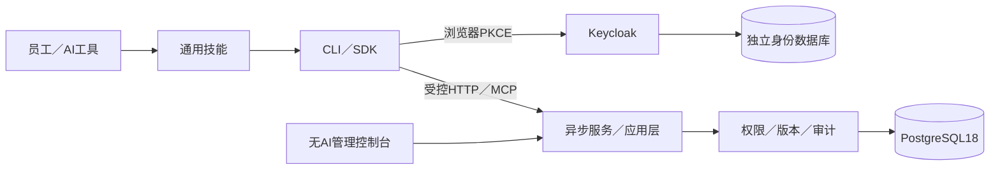

# 基座架构与扩展边界

Agent分支已按用户要求扩展为员工端与服务端均可运行AI；[智能体总体方案](AGENT_PLATFORM_DESIGN.md)是新方向，下面保留原数据治理链路的职责说明。当前员工端原型与内部异步工具桥已实现；服务端任务和Web对话尚未完成，不能据图宣称已部署。

每企业独立部署，内部多终端共享。服务端与Web没有模型、Agent或默认驱动客户端AI；所有AI理解和表达由员工宿主承担。SDK和服务协议均不直出SQL。

## 数据与权限

project是通用数据容器：每容器有版本化字段定义，记录关联明确修订。候选、确认、冻结、更正和历史分离。既有权限由权限项→权限集／角色→员工组合，实时在服务端核验；默认基础员工能力与管理权限分离。上传和查看自身数据为基础能力，但管理他人、确认和管理授权均需相应权限。

聚合支持受控条件、维度与预算，按字段类型及修订验证。没有通用跨容器语义映射、任意SQL、行业指标或无限查询。客户端整理业务规则，不能绕过服务端访问范围。

## 模块和配置

- office-data-service：服务端，内部app包稳定。
- clients/python：office-client发行包与office_client导入名固定；对外CLI命令可配置。
- office-skills：通用规则和data-access入口，不预留空行业技能。
- packages/api-contracts：独立契约实现，发行名 office-api-contracts，导入名 office_contracts；使用中立名称并保留许可来源。
- deploy／installers：服务器与员工分别安装。
- template.toml：公开品牌与初始身份唯一输入；生成资源受check约束；deploy/.env是实例环境参数；秘密另存。

产品内部数据库账号、realm、权限码和API路径采用稳定中立协议名称，不随着展示品牌变化；OAuth客户端和本机凭证命名空间由distribution.namespace派生。固定内部标识不影响不同企业独立部署；修改协议标识可能需要迁移，不能做成任意运行时开关。

扩展先判断是否可由字段定义、权限组合或现有查询满足；只有新规则才新增模块。保持应用层与传输适配分离，业务模块不反向依赖Web／HTTP／MCP。未来模板更新为源码升级，不提供自动覆盖企业代码；来源记录用于逐项合并。
