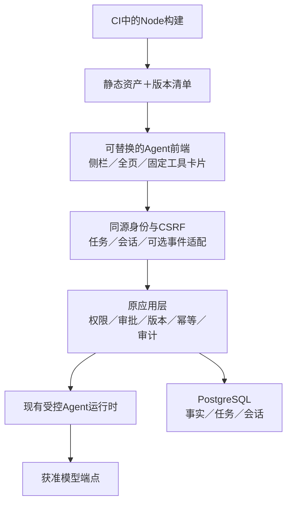

# Agent 前端路线与 CopilotKit 证据核查

日期：2026-10-27。本文为调研结论及验证计划，不是已采纳的架构或已实现功能。不执行新前端开发、模型调用、实例配置或发布。

## 1. 用户目标与前置状态

完整阅读用户提供的外部讨论：目标是复用CopilotKit官方示例所展现的Agent产品体验，包括侧栏、工具卡片、人在环、共享上下文和历史；并比较新React前端、隔离静态构建与全栈重建。不是复制整个CopilotKit平台。

本轮远端核查：已推送的Agent分支为dc8ec0b，main仍为94942ce，正式Release仅v1.0.0，未发现v1.1.0远端Tag或Agent合并PR。v1.1.0因缺少管理员模型配置闭环而暂停，不能称为发布完成。实时状态以后续GitHub核查为准；调研不解除暂停或授权启用模型。

## 2. 核查方法与固定来源

- 官方文档、官方GitHub源码及示例交叉核对，不凭示例截图判定可生产交付。
- 通过gh克隆CopilotKit/CopilotKit至忽略的references/upstream/copilotkit-20261027，只读分析；未安装或执行其依赖、postinstall、示例或模型。
- 固定分析提交：b0570a02db35dfd5e6bcffd3fa71c83a52c0de54。源码包版本1.81.0；官方latest Release本轮为v1.81.0。源码提交与Tag不假设为同一提交。
- 本项目锁定pydantic-ai-slim 2.61.0；已读其AG-UI适配器源码，确认存在适配路径，不等于已安装AG-UI额外依赖或实现企业端点。
- assistant-ui为对照候选，本轮仅核对官方ExternalStoreRuntime文档及仓库MIT许可元信息，未完成其源码／安装／体积／可访问性实测。

## 3. 对外部讨论的校正

| 外部说法 | 当前核查结果 | 对决策的影响 |
|---|---|---|
| 现有助手已有SSE | assistant-transport.js为JSON fetch，assistant-shell.js有界轮询；未见SSE端点 | 真实token流需要运行时／传输工作，不能只换渲染器或模拟打字 |
| React前端接上AG-UI即可，后端完全不动 | 当前受控任务API不是AG-UI事件端点 | 可保留领域／应用层，但需适配层；若只换UI，可先适配现有JSON状态 |
| React或Node必然要求客户安装Node | 开发／CI构建与运行环境是两回事 | 纯静态SPA可随Docker制品交付，由FastAPI／网关托管 |
| 静态导出整个官方示例即可摆脱Node | PydanticAI Todo示例有Next.js API Runtime路由 | 依赖服务端路由的示例不能仅静态导出；需另留Runtime或改连接方案 |
| 官方示例只能整体搬 | Sidebar、Chat等有组件及slot接口 | 可拆用组件，但依赖／许可／运行时仍需逐层核对 |
| 全栈重建会必然丢掉已验收边界 | 可以重用既有身份、权限和领域服务 | 重写不必丢规则，也不会自动更稳定；先明确实际解决的问题 |
| AG-UI一定要现在引入，以后零返工 | 协议不替代持久化、鉴权、审批与版本协调 | 值得隔离成适配器，不作为UI优化的无条件前置或零返工承诺 |
| 现阶段仍只是非AI服务端 | 模板Agent分支已实现服务端Agent | 不把早期茂泽服务端无AI约束重新套回当前模板 |

## 4. 现成组件、示例与运行时

### CopilotKit

本次主读v2 Chat／Sidebar、Provider、许可测试，及PydanticAI Todo、v2 React Demo、multi-page三个示例。

- v2入口集中于@copilotkit/react-core/v2，不能将旧版@copilotkit/react-ui、旧Provider prop和v2示例混用。
- v2 React Demo仍使用Next.js及Runtime；PydanticAI Todo使用CopilotKit 1.10.6，multi-page使用更早依赖。示例不是统一版本的生产模板，不能沿用其忽略锁文件、postinstall初始化或开发身份假设。
- 官方推荐Runtime连接。TypeScript Runtime可不使用Intelligence；当前Python Runtime README明确要求Intelligence项目密钥，不能将其描述为无条件独立的Python替代品。
- selfManagedAgents存在，不意味着使用agents__unsafe_dev_only即可生产。当前Provider源码明确发出Enterprise许可提示，Sidebar源码调用checkFeature("sidebar")并显示未许可提示。根LICENSE及react-core包声明MIT，但功能服务／商业支持及生产许可提示仍需逐项核对，不能推断所有开源代码收费，也不能承诺整套体验无许可条件。不得通过删除提示或冒用开发模式完成选型。
- web-components当前README只承诺threads-drawer，不能替代完整聊天界面。
- 依赖包含AG-UI、RxJS、Radix、Markdown、公式、虚拟列表、图表及其他渲染器。不能用依赖数量推算实际bundle；应对选定入口构建测量、审计第三方许可及遥测出口。

### assistant-ui

ExternalStoreRuntime由应用提供消息和回调，适合保留自有会话／任务状态的场景。它是UI和状态适配候选，不自动提供本项目审批、鉴权或数据库。若目标主要是成熟聊天组件而非CopilotKit Runtime生态，应与其对照验证，避免只在单一供应商方案内比较。

## 5. 路线比较与建议

| 路线 | 保留内容 | 新增运行依赖 | 判断 |
|---|---|---|---|
| 保持原生UI，借鉴示例体验 | 全部当前栈 | 可保持无Node运行服务 | 最小近期变更，但复杂状态组件的维护继续由项目承担 |
| React静态构建＋自有BFF／状态适配 | FastAPI、PG、Keycloak、领域与应用层 | Node在构建侧；能否无额外运行服务取决于选定UI适配方式 | 推荐作为下一阶段优先验证架构，不先绑定CopilotKit |
| React＋CopilotKit TypeScript Runtime | 原业务服务保留 | 通常新增Node Runtime服务 | 需要其完整生态时再选，必须核对许可、部署、身份转发和历史所有权 |
| 前后端整体重建 | 可重用领域规则但要明确迁移 | 由目标栈决定 | 当前未找到必须重写用户／权限／数据层才能解决UI问题的证据，不建议默认选择 |

“A路线”和“折中”不是互斥的产品架构：前者描述前端选型，后者描述构建／交付策略。任一路线都可采用多阶段Docker和CI静态构建。隔离构建也不自动消除Runtime服务。

推荐：以CopilotKit优秀示例作为体验参照，保留自有服务端基座，优先验证React＋TypeScript＋Vite静态交付。UI实现先对照CopilotKit的明确可交付方案与assistant-ui自有状态适配方案；许可／Runtime依赖及本项目审批兼容验证完毕后再定库。不是立即重写全部控制台，也不继续无限补原生JS。React局部挂载与全页SPA的导航、草稿及焦点边界需分开验收，不能假设换React会消除这些问题。

## 6. 建议的边界

- UI只提供用户输入、页面枚举及获准上下文；身份和权限由服务端决定。前端messages、tools、state、resume均不直接作为可信历史或批准事实。
- 继续使用服务端task／conversation、proposal、版本及幂等标识；不能把工具展示完成当成业务成功或确认。跨设备审批冲突、权限变化和旧预览必须拒绝。
- 生成式UI先限固定schema组件及校验后的参数，数字来自计算结果；不执行模型HTML／JS／URL。客户端页面刷新不能静默覆盖未保存表单。
- 事件流应由已有任务的权威状态／事件派生。订阅断开不等于停止任务，停止请求也不意味着回滚已提交事务。重连先核对状态，不重放写入。
- AG-UI可作为独立传输适配，不取代原REST业务契约。断线补偿、事件序号、快照、顺序、心跳、代理缓冲、负载与撤权需项目实现和验证，不是换协议自动获得。
- 不展示原始思维链或把活动阶段虚构成百分比；没有真实token流时明确显示正在处理，不用伪打字冒充实时输出。
- 管理员模型配置闭环仍是当前前置缺口，换聊天组件不会补齐设置、密钥存储、诊断、启停及权限审计。

## 7. 后续验证计划（未开始开发）

1. 先确认并补齐当前管理员模型配置方案、发布范围和验收，单独完成v1.1.0流程；不把前端探索混入已准备候选。
2. 在隔离分支构建两个最小UI验证：相同布局／卡片／任务状态，分别使用CopilotKit可交付路径和assistant-ui自有状态适配。只使用合成模型与数据，不默认调用真实供应商。
3. 比较实际bundle、依赖许可、遥测／外部请求、Node运行需求、构建复现、加载失败、键盘／IME、侧栏模态与移动端行为。不能只比较截图。
4. 核对服务端本人会话、实时撤权、历史隐藏、审批篡改／过期／重复、未知写入、取消与重连；禁止组件默认行为绕过原链路。
5. 如需要真正流式，先扩展受控运行时的事件投影，再验证AG-UI适配。保留原REST和当前界面回退，单独迁移导航与草稿状态。
6. 同一最终SHA构建Python包、静态manifest、源码包及镜像，验证新环境安装与升级；不在客户机器执行前端构建或引入开发服务器。

## 8. 官方来源

- [CopilotKit固定源码](https://github.com/CopilotKit/CopilotKit/tree/b0570a02db35dfd5e6bcffd3fa71c83a52c0de54)：packages/react-core、web-components、runtime-python及上述examples。
- [v1.81.0 Release](https://github.com/CopilotKit/CopilotKit/releases/tag/v1.81.0)。
- [React SPA](https://docs.copilotkit.ai/react-spa)：构建形态与Runtime位置。
- [Runtime](https://docs.copilotkit.ai/agno/backend/copilot-runtime)：语言、连接及自管边界。
- [v2 API](https://docs.copilotkit.ai/reference/v2)、[Sidebar](https://docs.copilotkit.ai/reference/components/CopilotSidebar)、[人在环](https://docs.copilotkit.ai/reference/hooks/useHumanInTheLoop)。
- [AG-UI事件](https://docs.ag-ui.com/concepts/events)。
- [PydanticAI AG-UI](https://pydantic.dev/docs/ai/integrations/ui/ag-ui/)：客户端输入信任、审批与协议版本边界；本项目需按锁定版本再验证。
- [assistant-ui ExternalStoreRuntime](https://www.assistant-ui.com/docs/runtimes/custom/external-store)、[官方仓库](https://github.com/assistant-ui/assistant-ui)。
- [CopilotKit定价与服务范围](https://www.copilotkit.ai/pricing)：用于识别产品服务边界，不代替逐文件许可审核或供应商书面确认；本轮不购买或接受协议。

## 9. 证据限制

完成附件全文、官方文档和指定源码路径静态核查；未声称读完上游全部仓库。未运行第三方示例、测量bundle、执行PoC、升级模型依赖或对模型发请求。本文是可执行调研结论，不是生产集成验收。未修改应用代码、现有实例或远端发布。
