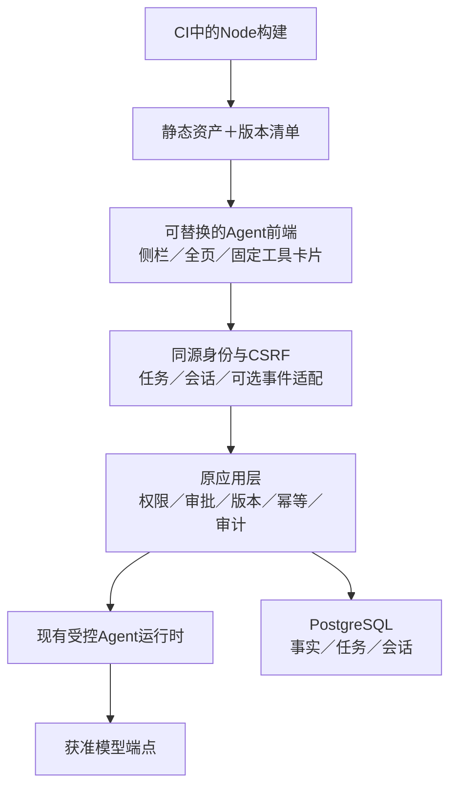

> 2026-10-28状态更新：本文记录前端调研时的缺口与建议。管理员模型配置P0已在当前分支补齐并进行隔离验收，见[管理操作与恢复](MODEL_CONFIGURATION_OPERATIONS.md)及[实施计划](plans/2026-10-28-model-configuration.md)。已有实例尚未更新，发布仍暂停；本文的“尚未实现”不覆盖该后续实现。

# Agent 前端路线与 CopilotKit 证据核查

日期：2026-10-27。状态：**调研完成，架构与实现方案待验证／确认**。本文为本轮讨论的唯一汇总入口，不代表已接入新前端、AG-UI或模型配置管理。

阅读顺序：第1～4节核实事实与证据；第5～6节说明路线与架构边界；第7节列出总体顺序；第8～9节保留来源和限制；第10～15节整理产品范围、配置前置、交互数据流、工程结构、执行验收及待决事项。

本文不执行新前端开发、模型调用、实例配置或发布。后续实现应更新本文件的状态和决策记录，不另起相互冲突的选型结论。

## 1. 用户目标与前置状态

完整阅读用户提供的外部讨论：目标是复用CopilotKit官方示例所展现的Agent产品体验，包括侧栏、工具卡片、人在环、共享上下文和历史；并比较新React前端、隔离静态构建与全栈重建。不是复制整个CopilotKit平台。

本轮远端核查：已推送的Agent分支为dc8ec0b，main仍为94942ce，正式Release仅v1.0.0，未发现v1.1.0远端Tag或Agent合并PR。v1.1.0因缺少管理员模型配置闭环而暂停，不能称为发布完成。实时状态以后续GitHub核查为准；调研不解除暂停或授权启用模型。

## 2. 核查方法与固定来源

- 官方文档、官方GitHub源码及示例交叉核对，不凭示例截图判定可生产交付。
- 通过gh克隆CopilotKit/CopilotKit至忽略的references/upstream/copilotkit-20261027，只读分析；未安装或执行其依赖、postinstall、示例或模型。
- 固定分析提交：b0570a02db35dfd5e6bcffd3fa71c83a52c0de54。源码包版本1.81.0；官方latest Release本轮为v1.81.0。源码提交与Tag不假设为同一提交。
- 本项目锁定pydantic-ai-slim 2.61.0；已读其AG-UI适配器源码，确认存在适配路径，不等于已安装AG-UI额外依赖或实现企业端点。
- assistant-ui为对照候选，本轮仅核对官方ExternalStoreRuntime文档及仓库MIT许可元信息，未完成其源码／安装／体积／可访问性实测。

## 3. 对外部讨论的校正

| 外部说法 | 当前核查结果 | 对决策的影响 |
|---|---|---|
| 现有助手已有SSE | assistant-transport.js为JSON fetch，assistant-shell.js有界轮询；未见SSE端点 | 真实token流需要运行时／传输工作，不能只换渲染器或模拟打字 |
| React前端接上AG-UI即可，后端完全不动 | 当前受控任务API不是AG-UI事件端点 | 可保留领域／应用层，但需适配层；若只换UI，可先适配现有JSON状态 |
| React或Node必然要求客户安装Node | 开发／CI构建与运行环境是两回事 | 纯静态SPA可随Docker制品交付，由FastAPI／网关托管 |
| 静态导出整个官方示例即可摆脱Node | PydanticAI Todo示例有Next.js API Runtime路由 | 依赖服务端路由的示例不能仅静态导出；需另留Runtime或改连接方案 |
| 官方示例只能整体搬 | Sidebar、Chat等有组件及slot接口 | 可拆用组件，但依赖／许可／运行时仍需逐层核对 |
| 全栈重建会必然丢掉已验收边界 | 可以重用既有身份、权限和领域服务 | 重写不必丢规则，也不会自动更稳定；先明确实际解决的问题 |
| AG-UI一定要现在引入，以后零返工 | 协议不替代持久化、鉴权、审批与版本协调 | 值得隔离成适配器，不作为UI优化的无条件前置或零返工承诺 |
| 现阶段仍只是非AI服务端 | 模板Agent分支已实现服务端Agent | 不把早期茂泽服务端无AI约束重新套回当前模板 |

## 4. 现成组件、示例与运行时

### CopilotKit

本次主读v2 Chat／Sidebar、Provider、许可测试，及PydanticAI Todo、v2 React Demo、multi-page三个示例。

- v2入口集中于@copilotkit/react-core/v2，不能将旧版@copilotkit/react-ui、旧Provider prop和v2示例混用。
- v2 React Demo仍使用Next.js及Runtime；PydanticAI Todo使用CopilotKit 1.10.6，multi-page使用更早依赖。示例不是统一版本的生产模板，不能沿用其忽略锁文件、postinstall初始化或开发身份假设。
- 官方推荐Runtime连接。TypeScript Runtime可不使用Intelligence；当前Python Runtime README明确要求Intelligence项目密钥，不能将其描述为无条件独立的Python替代品。
- selfManagedAgents存在，不意味着使用agents__unsafe_dev_only即可生产。当前Provider源码明确发出Enterprise许可提示，Sidebar源码调用checkFeature("sidebar")并显示未许可提示。根LICENSE及react-core包声明MIT，但功能服务／商业支持及生产许可提示仍需逐项核对，不能推断所有开源代码收费，也不能承诺整套体验无许可条件。不得通过删除提示或冒用开发模式完成选型。
- web-components当前README只承诺threads-drawer，不能替代完整聊天界面。
- 依赖包含AG-UI、RxJS、Radix、Markdown、公式、虚拟列表、图表及其他渲染器。不能用依赖数量推算实际bundle；应对选定入口构建测量、审计第三方许可及遥测出口。

### assistant-ui

ExternalStoreRuntime由应用提供消息和回调，适合保留自有会话／任务状态的场景。它是UI和状态适配候选，不自动提供本项目审批、鉴权或数据库。若目标主要是成熟聊天组件而非CopilotKit Runtime生态，应与其对照验证，避免只在单一供应商方案内比较。

## 5. 路线比较与建议

| 路线 | 保留内容 | 新增运行依赖 | 判断 |
|---|---|---|---|
| 保持原生UI，借鉴示例体验 | 全部当前栈 | 可保持无Node运行服务 | 最小近期变更，但复杂状态组件的维护继续由项目承担 |
| React静态构建＋自有BFF／状态适配 | FastAPI、PG、Keycloak、领域与应用层 | Node在构建侧；能否无额外运行服务取决于选定UI适配方式 | 推荐作为下一阶段优先验证架构，不先绑定CopilotKit |
| React＋CopilotKit TypeScript Runtime | 原业务服务保留 | 通常新增Node Runtime服务 | 需要其完整生态时再选，必须核对许可、部署、身份转发和历史所有权 |
| 前后端整体重建 | 可重用领域规则但要明确迁移 | 由目标栈决定 | 当前未找到必须重写用户／权限／数据层才能解决UI问题的证据，不建议默认选择 |

“A路线”和“折中”不是互斥的产品架构：前者描述前端选型，后者描述构建／交付策略。任一路线都可采用多阶段Docker和CI静态构建。隔离构建也不自动消除Runtime服务。

推荐：以CopilotKit优秀示例作为体验参照，保留自有服务端基座，优先验证React＋TypeScript＋Vite静态交付。UI实现先对照CopilotKit的明确可交付方案与assistant-ui自有状态适配方案；许可／Runtime依赖及本项目审批兼容验证完毕后再定库。不是立即重写全部控制台，也不继续无限补原生JS。React局部挂载与全页SPA的导航、草稿及焦点边界需分开验收，不能假设换React会消除这些问题。

## 6. 建议的边界

- UI只提供用户输入、页面枚举及获准上下文；身份和权限由服务端决定。前端messages、tools、state、resume均不直接作为可信历史或批准事实。
- 继续使用服务端task／conversation、proposal、版本及幂等标识；不能把工具展示完成当成业务成功或确认。跨设备审批冲突、权限变化和旧预览必须拒绝。
- 生成式UI先限固定schema组件及校验后的参数，数字来自计算结果；不执行模型HTML／JS／URL。客户端页面刷新不能静默覆盖未保存表单。
- 事件流应由已有任务的权威状态／事件派生。订阅断开不等于停止任务，停止请求也不意味着回滚已提交事务。重连先核对状态，不重放写入。
- AG-UI可作为独立传输适配，不取代原REST业务契约。断线补偿、事件序号、快照、顺序、心跳、代理缓冲、负载与撤权需项目实现和验证，不是换协议自动获得。
- 不展示原始思维链或把活动阶段虚构成百分比；没有真实token流时明确显示正在处理，不用伪打字冒充实时输出。
- 管理员模型配置闭环仍是当前前置缺口，换聊天组件不会补齐设置、密钥存储、诊断、启停及权限审计。

## 7. 后续验证计划（未开始开发）

1. 先确认并补齐当前管理员模型配置方案、发布范围和验收，单独完成v1.1.0流程；不把前端探索混入已准备候选。
2. 在隔离分支构建两个最小UI验证：相同布局／卡片／任务状态，分别使用CopilotKit可交付路径和assistant-ui自有状态适配。只使用合成模型与数据，不默认调用真实供应商。
3. 比较实际bundle、依赖许可、遥测／外部请求、Node运行需求、构建复现、加载失败、键盘／IME、侧栏模态与移动端行为。不能只比较截图。
4. 核对服务端本人会话、实时撤权、历史隐藏、审批篡改／过期／重复、未知写入、取消与重连；禁止组件默认行为绕过原链路。
5. 如需要真正流式，先扩展受控运行时的事件投影，再验证AG-UI适配。保留原REST和当前界面回退，单独迁移导航与草稿状态。
6. 同一最终SHA构建Python包、静态manifest、源码包及镜像，验证新环境安装与升级；不在客户机器执行前端构建或引入开发服务器。

## 8. 官方来源

- [CopilotKit固定源码](https://github.com/CopilotKit/CopilotKit/tree/b0570a02db35dfd5e6bcffd3fa71c83a52c0de54)：packages/react-core、web-components、runtime-python及上述examples。
- [v1.81.0 Release](https://github.com/CopilotKit/CopilotKit/releases/tag/v1.81.0)。
- [React SPA](https://docs.copilotkit.ai/react-spa)：构建形态与Runtime位置。
- [Runtime](https://docs.copilotkit.ai/agno/backend/copilot-runtime)：语言、连接及自管边界。
- [v2 API](https://docs.copilotkit.ai/reference/v2)、[Sidebar](https://docs.copilotkit.ai/reference/components/CopilotSidebar)、[人在环](https://docs.copilotkit.ai/reference/hooks/useHumanInTheLoop)。
- [AG-UI事件](https://docs.ag-ui.com/concepts/events)。
- [PydanticAI AG-UI](https://pydantic.dev/docs/ai/integrations/ui/ag-ui/)：客户端输入信任、审批与协议版本边界；本项目需按锁定版本再验证。
- [assistant-ui ExternalStoreRuntime](https://www.assistant-ui.com/docs/runtimes/custom/external-store)、[官方仓库](https://github.com/assistant-ui/assistant-ui)。
- [CopilotKit定价与服务范围](https://www.copilotkit.ai/pricing)：用于识别产品服务边界，不代替逐文件许可审核或供应商书面确认；本轮不购买或接受协议。

## 9. 证据限制

完成附件全文、官方文档和指定源码路径静态核查；未声称读完上游全部仓库。未运行第三方示例、测量bundle、执行PoC、升级模型依赖或对模型发请求。本文是可执行调研结论，不是生产集成验收。未修改应用代码、现有实例或远端发布。

## 10. 产品范围：要获得什么体验

### 10.1 当前已存在与需要演进的能力

| 能力 | 当前源码事实 | 下一阶段目标／边界 |
|---|---|---|
| 全局助手入口、侧栏、全页工作区 | 已有共享原生JS界面 | 换用成熟组件时保持一个会话／任务来源，不形成两套聊天产品 |
| 历史搜索、改名、归档、续问 | 已有本人持久会话及有界读取 | 新组件接现有服务；不默认启用供应商第二份历史库 |
| 工具回执与变更预览 | 已有受控工具、回执和审批展示 | 升级为固定类型卡片；完整预览及独立详情仍可访问 |
| 提交、执行、待确认、结果未知 | 已有权威任务状态 | UI严格映射状态，不根据模型语气判成功 |
| 即时文本流 | 未实现token SSE | 如选定范围包含流式，先补运行时事件与可恢复传输，不做伪打字 |
| 页面上下文 | 当前仅受限页面枚举 | 项目／筛选等上下文需新契约、权限及预算，不默认上传整个页面 |
| 模型管理 | 文件配置，无控制台配置闭环 | 单独补齐管理员设置与诊断，不依赖新聊天框完成 |
| 任意生成页面／执行代码 | 不属于当前基座能力 | 不列入首期；先固定组件与结构化参数 |

表格的“已有”指源码与历史限定测试，不表示当前运行镜像已更新或功能已在每个企业上线。

### 10.2 建议的首批组件

一个共享ChatSurface承载侧栏与全页布局，复用会话列表、消息、输入区、状态和卡片，不分别实现状态机。建议首批卡片：

- 读取结果：摘要、字段、表格、覆盖范围、截断／分页提示；详情按需读取。
- 变更预览：真实目标、变更前后、风险及影响、版本、明确的批准／拒绝入口；不给模型新增批准能力。
- 执行回执：真实操作、完成时间、结果与追踪信息；模型说明与回执分开。
- 异常：权限变化、版本冲突、配置未启用、网络中断、结果待核实分别表达，不用统一“失败请重试”。

建议提示词只填草稿，不自动执行；提示内容与可见操作依权限生成，但后端仍独立校验。输入支持中文IME，草稿保护、键盘操作、自动滚动及加载状态不能因组件默认行为退化。

## 11. 当前前置缺口：管理员模型配置闭环草案

以下是拟议功能，不是已经存在的设置页；不在本轮修改服务配置或读取密钥。

| 模块 | 拟议职责 | 不应做的事 |
|---|---|---|
| 状态与诊断 | 区分依赖缺失、尚未配置、配置无效、未启用、已就绪，给出处理入口 | 把本地就绪称为供应商可用或企业数据已获准 |
| 模型连接 | 复用AgentConfig支持的协议、端点、模型与超时 | 在前端或新模块另造不兼容配置模型 |
| 运行预算 | 复用Limits的工具、请求、时长、输入输出预算 | 以模型提示词替代硬预算或允许无限任务 |
| 密钥 | 受限写入／替换／清除、已配置标记；现有文件／环境引用的兼容策略另定 | 查询接口回显明文、空值误清除、把密钥送给助手或写审计正文 |
| 检查与测试 | 结构检查无需模型；真实连接测试显式说明调用与费用 | 保存时自动外发数据或自动调用模型 |
| 生效与启停 | 明确版本、是否需重启、失败保持哪份生效配置、活动任务如何处理 | 保存成功却让用户误认为已生效，或直接终止在途写入 |
| 权限与审计 | 独立可配置权限，记录操作者、版本、动作与脱敏结果 | 因拥有agent.run或固定角色名就允许管理模型 |

配置页必须在服务器端执行权限、版本及CSRF校验；端点变更涉及网络出口，应限制受信任来源并防止将服务端变成任意地址代理。秘密写入后端、端点策略、配置版本存储及热加载方案尚未确定，不能从这张表直接推定为数据库明文存储或任意路径写文件。

当前HTTP演示环境可用于无秘密的界面／合成数据验收，不将通过明文HTTP提交正式模型密钥作为生产方案。正式秘密传输及模型调用需要目标环境条件与明确授权。

## 12. 端到端交互与状态所有权

| 阶段 | 服务端事实与动作 | 前端职责／异常处理 |
|---|---|---|
| 打开助手 | 当前身份、agent.run、配置状态及本人会话查询 | 展示可用状态；管理员有设置入口，普通员工有明确说明 |
| 提交消息 | 校验输入与预算；沿用request_key幂等受理 | 先取得受理回执；丢失回执时查状态，不重新生成意图盲投 |
| 运行与读取 | 原工具按实时权限执行，写入前冻结预览 | 订阅／轮询状态，展示实际工具结果与覆盖范围 |
| 等待确认 | proposal、版本、本人身份和待批任务由服务器持有 | 展示完整预览并确认；仅传受控决定，不传模型伪造的批准事实 |
| 应用变更 | 再核权限、版本与幂等，写入及审计 | 展示真实回执；刷新关联页面前检查草稿，不静默覆盖 |
| 取消／断线 | 取消请求与订阅断开分开；保留已提交事务和未知结果 | 停止订阅不声称任务已停止；重新进入先读取权威状态 |
| 继续会话 | 从本人服务端历史建立上下文，检查权限指纹变化 | 不将浏览器缓存历史重新当可信服务端记录上传 |

AG-UI如果采纳，只是UI适配协议；原HTTP业务响应、错误码、批量语义和数据库规则保持独立。适配层需定义threadId/runId/toolCallId与现有标识的映射，不允许各层各自创建无法关联的任务记录。

事件持久化、序号／游标、重连时从何处补读尚未实现。设计时优先保证“快照可恢复、事件可关联、写入不重放”；不要把WebSocket或SSE选择本身等同于可靠性。状态同步只接受允许字段，不把客户端JSON Patch直接应用为业务库更新。

## 13. 工程、交付和兼容边界草案

以下只表示模块职责，不提前创建空目录或改变仓库结构：

| 建议模块 | 职责 |
|---|---|
| web-app/ | 备选React＋TypeScript前端源码、锁文件和测试；名字在采纳时再确认 |
| UI组件层 | 布局、输入、消息、工具卡片和可访问性，不直接保存身份秘密 |
| 状态适配层 | 把原本人会话／任务模型映射为UI库需要的状态；UI库可替换 |
| 现有Web BFF | 同源会话与CSRF、受控读取／变更；可选流式出口，不复制领域规则 |
| 原应用／Agent层 | 执行、权限、预览、确认、审计与预算；不会迁入浏览器 |
| CI与打包 | 依锁文件构建静态资产，产出manifest／哈希／来源，纳入wheel及镜像验证 |

部署仍以独立企业服务器＋员工终端为边界。若选择静态SPA，客户服务器接收已构建产物，不运行npm开发服务器；若选择CopilotKit Runtime服务，应在Compose、健康检查、升级恢复和运维文档中明确列为运行依赖，不能藏在“静态前端”名义下。

静态资源使用内容哈希和合适缓存；HTML／manifest与后端版本一致。资源基路径、直接访问深层路由、登录重定向、登出、CSP、浏览器缓存旧JS及回退界面都要测试。默认同源，不把宽泛CORS当成身份接入方案。

替换策略宜先限定助手区域，保留原管理入口；如果后续迁移整个控制台，另列人员、权限、授权、审计、筛选分页等页面的功能对账，不能把聊天框替换称为全部UI迁移。一次只保留一个主动助手实例，避免双轮询、重复审批或两份草稿。

## 14. 阶段计划与验收门槛

| 阶段 | 交付物 | 通过条件 | 当前状态 |
|---|---|---|---|
| P0 既有发布阻断 | 模型配置闭环方案、权限／秘密／生效策略及实现验收 | 管理员能完成明确的配置流程；普通员工不能管理；无模型或错误配置时原业务可用 | 未完成，发布暂停 |
| P1 对照验证 | 相同任务和卡片的两个最小UI验证、版本／许可／依赖记录 | 明确Runtime和许可；对比实际构建、网络出口、功能与维护差异 | 未实施 |
| P2 选型记录 | 可采纳或否决的ADR、目标模块边界 | 不凭截图或假定成本决定；未决项有处理办法 | 待P1 |
| P3 受控集成 | 单一助手UI与原会话／任务链路适配 | 权限、预览、批准、回执、草稿和身份不退化 | 未实施 |
| P4 可选流式 | 权威事件投影及必要协议适配 | token来源真实；断线、撤权、取消、重连、重复事件可核验 | 按选定范围决定 |
| P5 交付与迁移 | 同源候选、镜像、安装／升级与回退记录 | 最终main CI通过，制品一致，新环境独立部署验证 | 未实施 |

对照验证至少覆盖：

- 三种当前模型协议的兼容边界；未运行真实模型的部分明确标注为替身协议验证。
- 慢请求、空结果、错误配置、超时、断线、重复点击、停止、页面刷新及多标签页。
- 本人／他人会话、权限实时撤回、过期预览、重复决定、提案篡改和结果未知。
- 中文IME、键盘、焦点返回、侧栏／模态切换、长表格／代码、减少动态效果和窄屏。
- 只读与写入回执、部分覆盖、分页截断、缺少字段；不按模型说明伪装成功。
- 冷启动、静态资源大小、交互延迟与长会话内存：先记录测量环境和基线，再定合理门槛；本轮没有编造体积、工期或性能数字。
- 普通服务、可选Agent服务和员工客户端继续独立工作；不能强迫所有用户安装模型运行时。

## 15. 决策登记与下一次接手

| 项目 | 当前口径 |
|---|---|
| 用户目标 | 获得成熟Agent应用体验；可调研不同前端／全栈路线 |
| 本轮推荐 | 保留自有业务基座，优先验证React静态交付和可替换UI适配 |
| 尚未采纳 | CopilotKit／assistant-ui最终选库、AG-UI端点、Node Runtime、整站SPA |
| 当前阻断 | 管理员模型配置尚未形成可操作闭环，v1.1.0没有正式发布 |
| 不在本轮执行 | 新前端开发、秘密录入、真实模型测试、运行实例变更、远端发布 |
| 主要风险 | 许可与依赖演进、额外运行时、双份会话／身份、流式恢复、前端草稿退化 |
| 后续顺序 | 先处理发布前置，再在隔离范围做P1并记录ADR，最后按批准范围实施 |

接手时先读取本文件、AGENTS.md、AGENT_OPERATIONS.md和当前发布记录，再核查Git／GitHub实际状态。第1节的提交号是历史快照，不作为“已经推送／发布”的动态真值。若另一次会话改变选型，应在本文件追加决策原因、证据及替代关系，并同步README和AGENTS入口，不修改历史证据使其看似从未发生。
